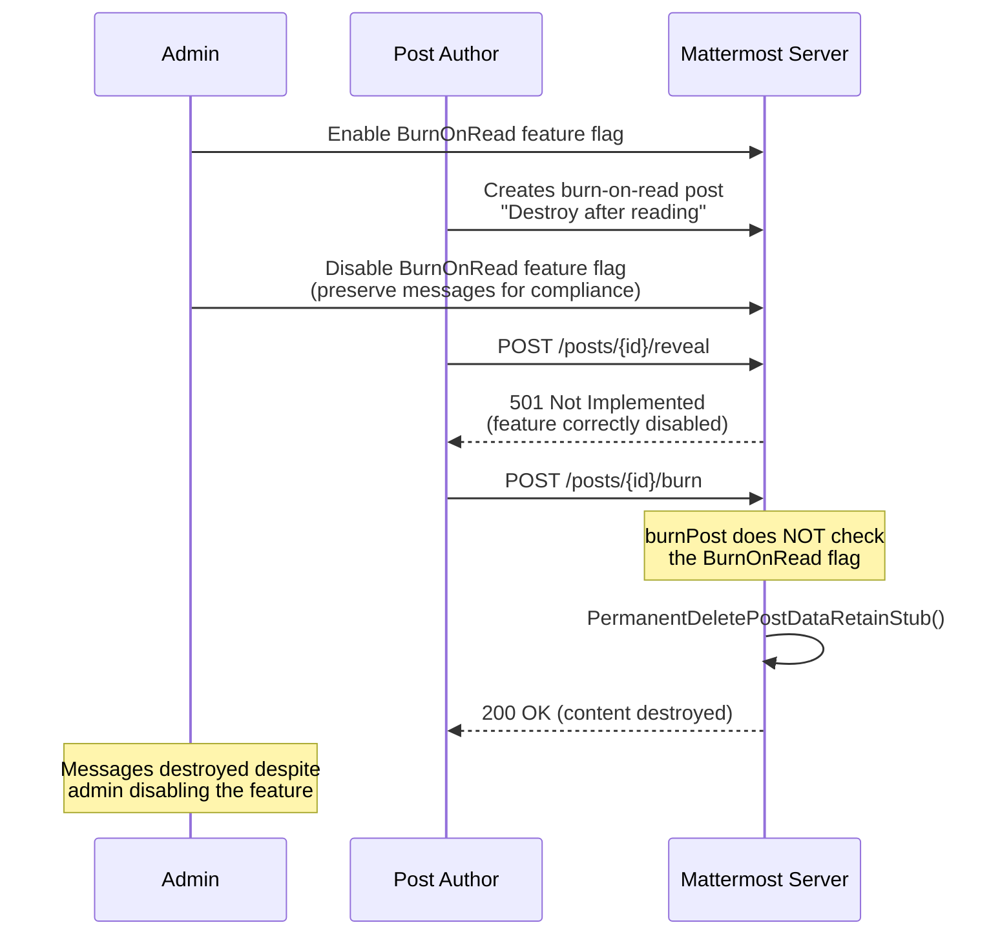

# BurnPost Bypasses Disabled BurnOnRead Feature Flag

The `burnPost` API handler does not check the `BurnOnRead` feature flag before permanently destroying a burn-on-read post. The parallel `revealPost` handler correctly checks this flag and returns 501 when disabled. When an admin disables BurnOnRead to preserve messages for legal hold or compliance, users can still permanently destroy post content by calling `POST /api/v4/posts/{id}/burn`.

**Affected versions:** Mattermost server with BurnOnRead feature (the vulnerable code path has been present since burnPost was introduced).

## What is the vulnerability

`burnPost` at line 1978 of `server/channels/api4/post.go` goes straight to permission checks without verifying the feature flag:

```go
func burnPost(c *Context, w http.ResponseWriter, r *http.Request) {
    c.RequirePostId()
    // ... directly proceeds to burn
```

Compare with `revealPost` at line 1920 which correctly checks:

```go
if !c.App.Config().FeatureFlags.BurnOnRead {
    c.Err = model.NewAppError("revealPost", "api.post.reveal_post.disabled.app_error",
        nil, "", http.StatusNotImplemented)
    return
}
```

The app layer `BurnPost` in `app/post.go` line 4482 also lacks this check. When the author calls burn, it hits `PermanentDeletePostDataRetainStub` which destroys the post content entirely.

## How the attack works



## What you need

- Python 3
- `requests` library (`pip install requests`)
- A Mattermost instance with BurnOnRead feature
- An admin personal access token (to toggle the feature flag)
- A regular user personal access token

## Setup

The exploit has three modes:

| Mode | What it does | When to use |
|------|-------------|-------------|
| `setup` | Enables BurnOnRead, creates a burn-on-read post | First step, needs both tokens |
| `exploit` | Disables BurnOnRead, shows revealPost blocked but burnPost succeeds | After setup, needs post ID |
| `auto` | Runs setup then exploit automatically | Full demo in one command |

### Full automated test

```
python exploit.py auto --url http://localhost:8065 --admin-token <admin_pat> --user-token <user_pat>
```

### Manual two-step

**Step 1** - create a burn-on-read post while the feature is enabled:

```
python exploit.py setup --url http://localhost:8065 --admin-token <admin_pat> --user-token <user_pat>
```

Note the post ID from the output.

**Step 2** - disable the feature and burn the post anyway:

```
python exploit.py exploit --url http://localhost:8065 --admin-token <admin_pat> --user-token <user_pat> --post-id <post_id>
```

The exploit disables the BurnOnRead flag, shows that `revealPost` correctly returns 501, then shows that `burnPost` succeeds and permanently destroys the content.

### All options

```
python exploit.py auto --url http://localhost:8065 --admin-token xxx --user-token yyy
python exploit.py setup --url http://localhost:8065 --admin-token xxx --user-token yyy
python exploit.py exploit --url http://localhost:8065 --admin-token xxx --user-token yyy --post-id abc123
```

## Impact

- Admin intent to disable BurnOnRead is violated
- Post authors can permanently delete post content when the feature should be disabled
- In compliance scenarios, this allows evidence destruction. An admin who disables BurnOnRead to preserve message history for legal hold or compliance review would find that users can still destroy messages
- The author path calls `PermanentDeletePostDataRetainStub` which destroys the post content entirely

## Fix

Add the same feature flag check from `revealPost` to the beginning of `burnPost`:

```go
func burnPost(c *Context, w http.ResponseWriter, r *http.Request) {
    if !c.App.Config().FeatureFlags.BurnOnRead {
        c.Err = model.NewAppError("burnPost", "api.post.burn_post.disabled.app_error",
            nil, "", http.StatusNotImplemented)
        return
    }
    // ... rest of handler
```
